# Nomad Card Tools

Simple tools to set up and fill a Nomad SD card from your computer. One menu copies your media
on and checks what will show up, adds offline Wikipedia, fixes videos that won't play, and gets
maps and translation packs onto the card.

Works on **Windows** and **Linux**. macOS should work too, but it's **untested at the moment**,
so treat it as experimental for now.

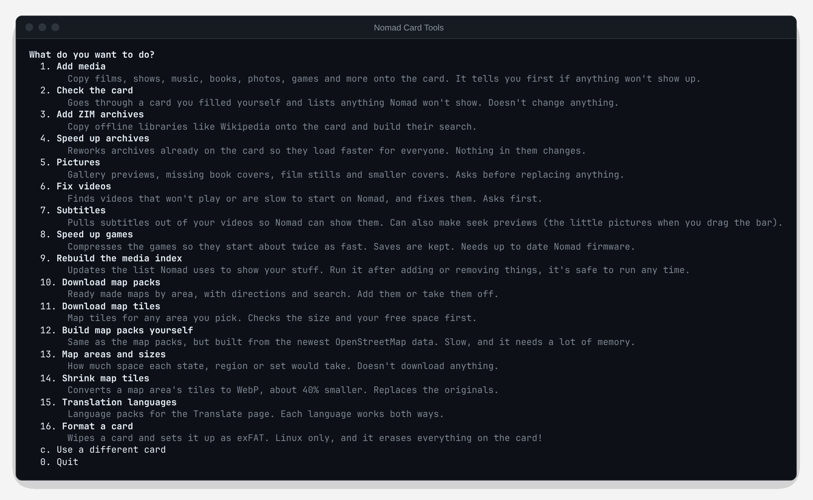

---

## Start here

- **Windows:** double-click **`START-Windows.bat`**
- **Linux:** open a terminal in this folder and run **`./start-linux.sh`**

The first time, it sets up the libraries the tools need (this needs internet once). After that
a menu opens. It finds your Nomad card, you pick it from the list, and then you choose what you
want to do. You can do as many jobs as you want in a row, then pick **0** to quit.

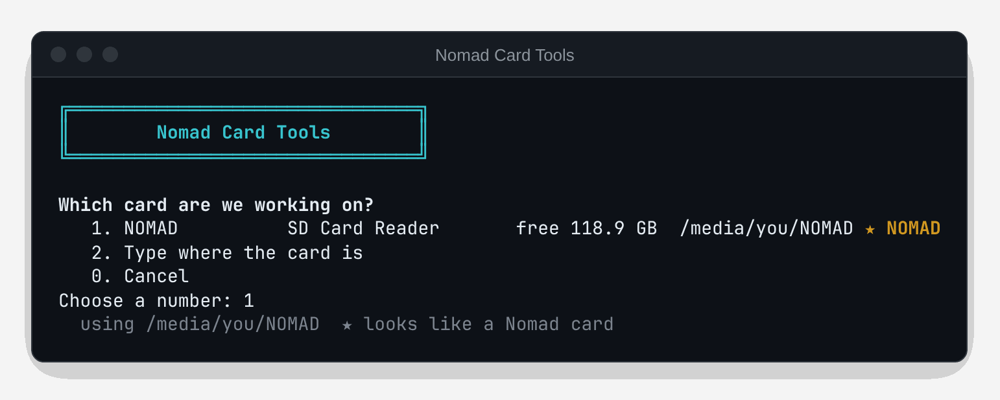

If your card doesn't show up, pick **"Type where the card is"** and enter where it is, for
example `E:\` on Windows or `/media/you/NOMAD` on Linux.

---

## Everything it can do

| | |
|---|---|
| **Your media** | [Add media](#1-add-media), [Check the card](#2-check-the-card), [Rebuild the media index](#9-rebuild-the-media-index) |
| **Offline libraries** | [Add ZIM archives](#3-add-zim-archives), [Speed up archives](#4-speed-up-archives) |
| **Make it play well** | [Pictures](#5-pictures), [Fix videos](#6-fix-videos), [Subtitles](#7-subtitles), [Speed up games](#8-speed-up-games) |
| **Maps** | [Download map packs](#10-download-map-packs), [Download map tiles](#11-download-map-tiles), [Build map packs yourself](#12-build-map-packs-yourself), [Map areas and sizes](#13-map-areas-and-sizes), [Shrink map tiles](#14-shrink-map-tiles) |
| **Translation** | [Translation languages](#15-translation-languages) |
| **The card** | [Format a card](#16-format-a-card) |

Map packs, Gallery previews and Speed up games need Nomad 4.8 (the experimental branch for
now), firmware and card files both.

---

## What the tools do

### 1. Add media
Copies films, shows, books, music, photos, games, recipes or 3D models onto the card, into the
folder whose page shows them.

- Point it at a file or a folder, then pick where on the card it goes.
- Before anything gets copied it tells you what the page will show, and what will copy but
  never show up, and why.
- Episodes dropped loose into **Shows** never show up, so it offers to put them in a show
  folder for you.
- When it's done it offers to rebuild the media index.

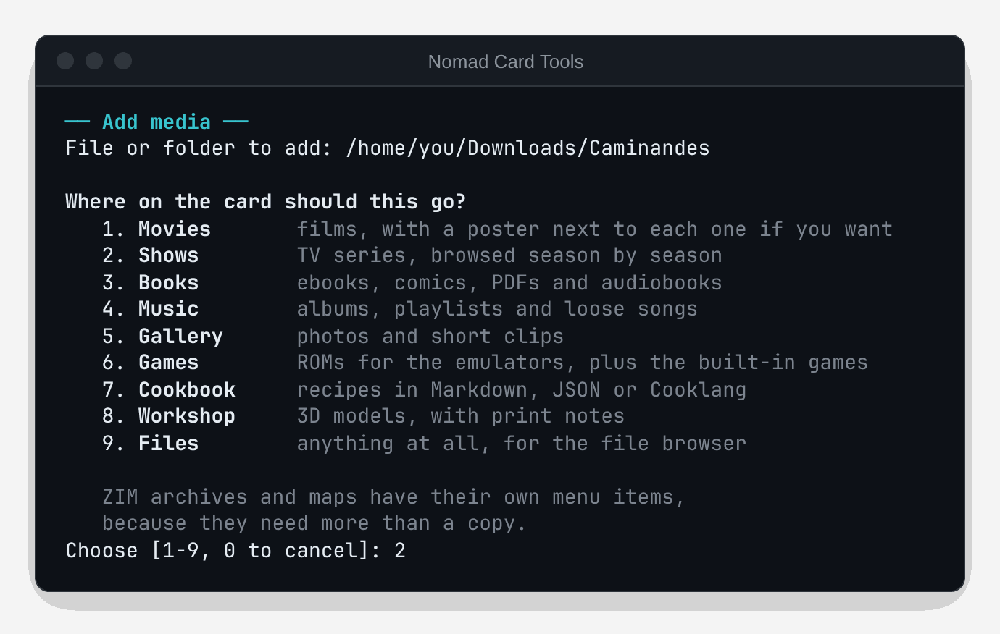

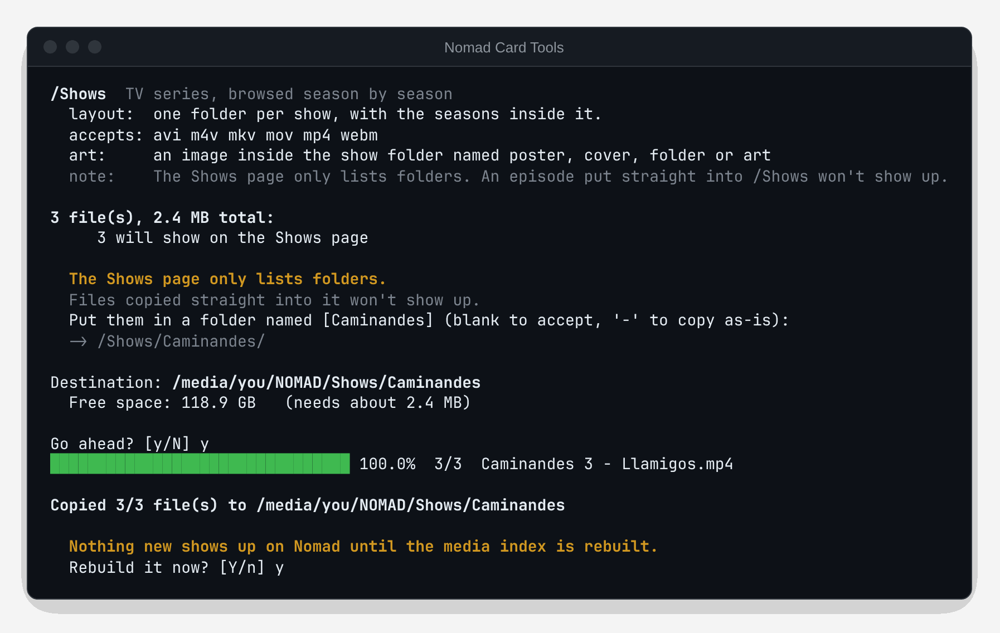

### 2. Check the card
For a card you filled yourself. It goes through every folder and tells you what Nomad will
show, what it'll skip and why, and if the index needs rebuilding. It checks **Maps** and
**Archive** too. Nothing on the card gets changed.

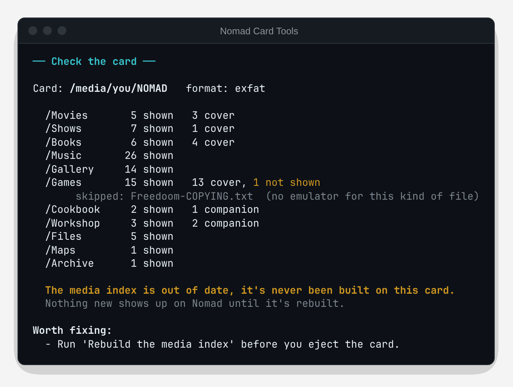

### 3. Add ZIM archives
Copies offline libraries (Wikipedia, Gutenberg and so on) onto the card and builds the search
so Nomad can find articles.

- Point it at a single `.zim` file or a whole folder of them.
- New archives are **added to** what's already on the card, it doesn't erase your existing
  ones.
- Adding a file that's already there (same name) just replaces that one.
- Point it at the card's own `/Archive` folder to build the search for archives already on it.
- It offers to speed them up while they copy (see #4). I'd say yes unless you're in
  a hurry.
- Tested with full size Wikipedia maxi + images.

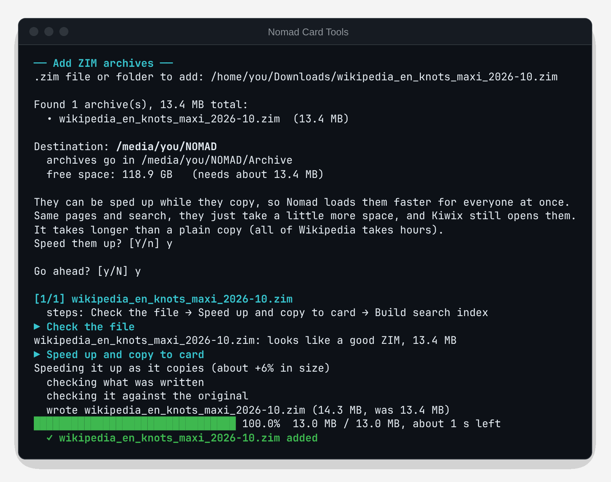

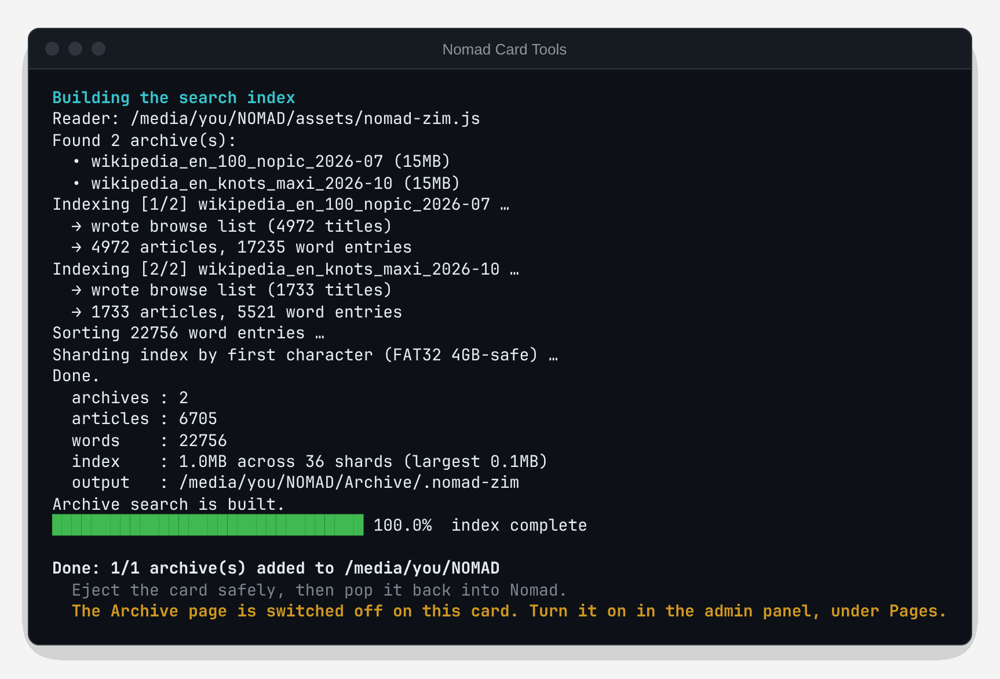

### 4. Speed up archives
Reworks archives already on the card so they load a lot faster, even with several phones on at
once. Same pages, pictures and search, Kiwix still opens them.

- Most archives grow a bit (0 to 5%). If one would grow more than 15% it's left alone, Nomad
  still shows it fine.
- It needs free space about the size of the biggest archive you pick.
- Do this with the card in a card reader only, not over Nomad's USB mode. 
- Big ones take a while: minutes for most, hours for all of Wikipedia. If it gets stopped
  part way, the next run finishes it first.

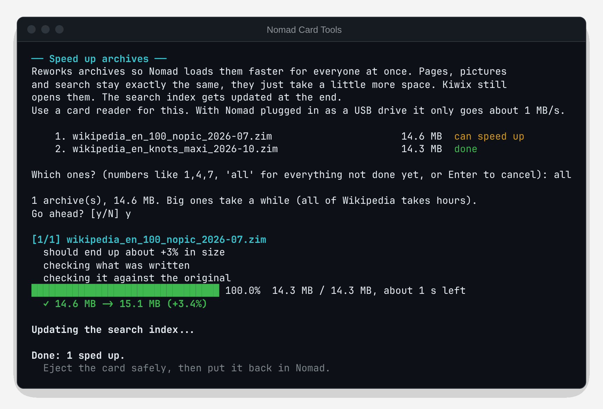

### 5. Pictures
Makes the pictures the pages show smaller so they load fast. It looks over the card, tells you
what each job would do, and you choose:

- **Gallery previews.** A small copy of every photo and a still from every clip, kept in a
  hidden folder in `/Gallery`. Your photos are never changed. *Add media* does this for you
  when it copies into the Gallery.
- **Covers for books.** Comics, ebooks, PDFs and audiobooks without a cover get one, saved next
  to them with the same name (`Book.epub` + `Book.jpg`). (pulled from the 1st image inside the books file). 
- **Stills for films.** Films and shows without a cover get a still from the film. Only if you
  pick it.
- **Shrink covers.** Covers in Movies, Shows, Books and Games wider than 200 px.
- **Shrink recipe photos.** Photos in Cookbook wider than 800 px.

The first three only add files. The two shrink jobs **replace** the pictures (no backup), so
they ask you to type YES first.

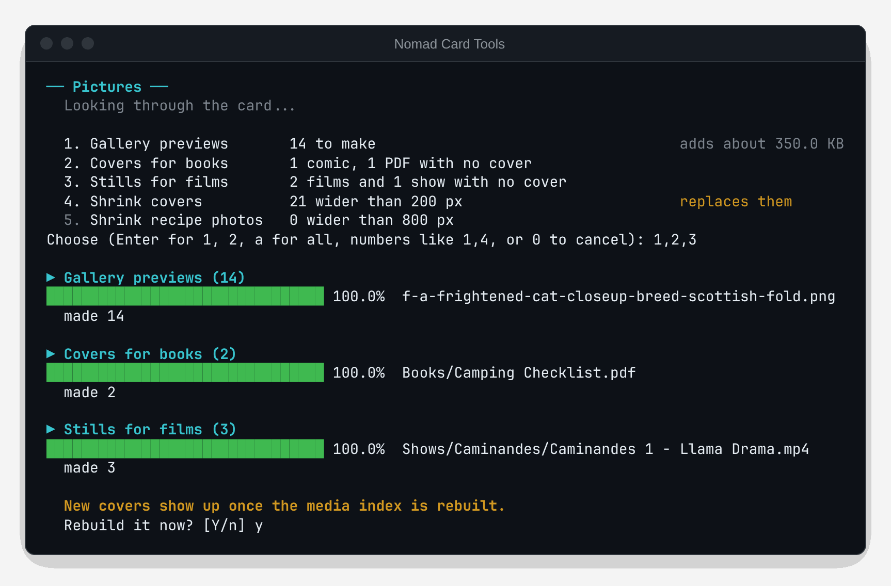

### 6. Fix videos
Finds videos that won't play, play without sound, or take a long time to start on Nomad, and
fixes them. It's the same check as **Check videos** in Nomad's admin panel, so those marks go
away afterwards.

- It shows you what it found and what it can fix, then asks before changing anything. Use
  `--check` to just see the list.
- **MKV and AVI** files get copied into MP4 so iPhones can play them. Text subtitles inside
  get saved next to the film as `.srt`.
- **Dolby, DTS and FLAC sound** gets changed to AAC so it plays in every browser.
- Video that no browser can play (old DivX/Xvid, 10-bit, MPEG-2) gets **converted** to 720p.
  This one is slow.
- HEVC, AV1, 4K and really big files play on some devices, so those only get converted if you
  say yes.
- Each video is replaced once its new copy has been checked. Keep the originals somewhere else
  if you might want them back.
- Works on a folder on your computer too, so you can fix files before copying them over.

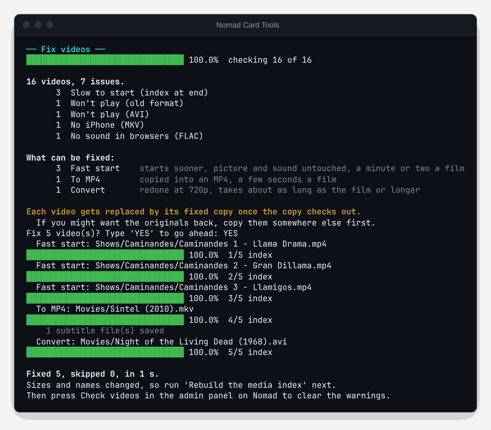

### 7. Subtitles
Two jobs for **Movies** and **Shows**. It tells you what each would do, and you pick.

- **Subtitles:** text subtitles inside a video get saved next to it as `Name.srt` (or
  `Name.eng.srt` and so on if the track says its language). Nomad's player shows them. Picture
  subtitles (the kind on Blu-ray and DVD rips) can't be turned into text, so it just counts
  those.
- **Seek previews** (off unless you pick it): a little picture shows where you'll land while
  you drag the progress bar. It saves a small `.thumbs.vtt` file and a few pictures next to
  each video, about 300 KB a film.
- It only adds files. Running it again only makes what's missing.

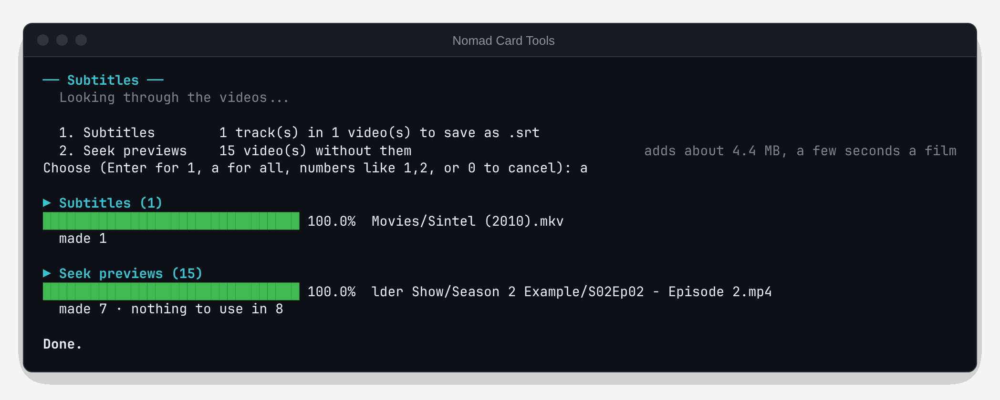

### 8. Speed up games
Compresses the games in **Games** so each one starts in about half the time. Covers and the
saves on people's phones keep working like before.

- Needs Nomad firmware 4.8 or newer. On an older Nomad the compressed games won't start,
  `python3 games_prepare.py --undo` puts them back.

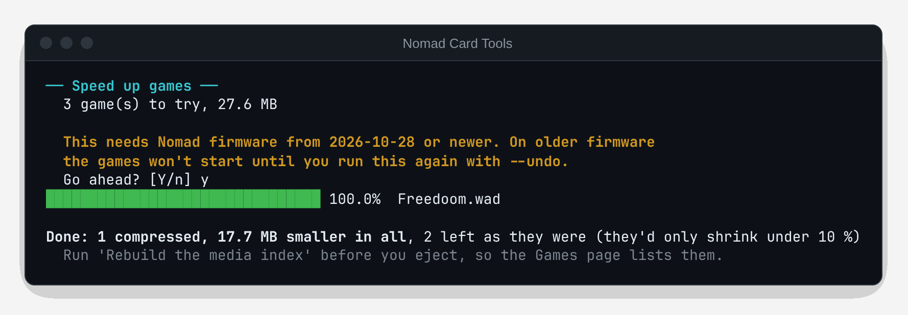

### 9. Rebuild the media index
Updates the list Nomad uses to show your stuff, after you've added or removed files. Nothing
gets deleted, it's safe to run any time.

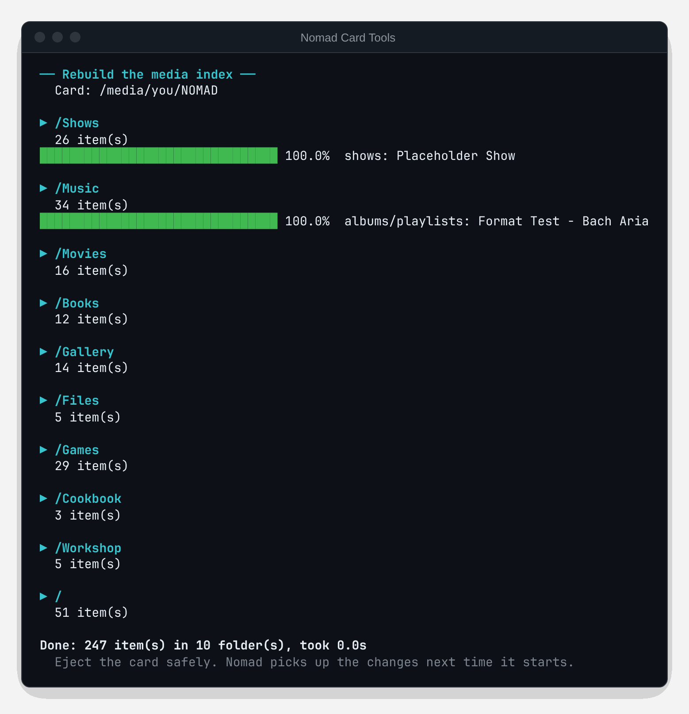

### 10. Download map packs
Ready made maps for Nomad's **Maps** page, by area (a US state, a Canadian province, a country
or part of one), with a street map, **turn by turn directions** and **place search**.

Prebuilt packs are the easy option, but building them yourself (see #12) is the better one.
You get the newest OpenStreetMap data and pick what each area gets.

- For now the packs cover the USA, BC, Alberta, Yukon, Switzerland, Liechtenstein and Austria.
  Anywhere else, build them yourself.
- Start from a collection (everything, a country, or a US region like New England), or pick
  areas yourself.
- The base packs an area needs come along the first time, like the zoomed out world map and
  the highways around it, so directions still work across areas you don't have.
- Nothing gets stored twice. Areas next to each other share the map along their border.
- Take packs off the same way (type `r` at the list).
- It shows the sizes and checks your free space first. If a download stops, run it again and
  it picks up where it left off.
- Needs internet while it downloads, nothing after that.

### 11. Download map tiles
Downloads map tiles for any area you pick, so the **Maps** page works with no internet. You
give it a name, the area (four numbers, it shows you how to get them from openstreetmap.org)
and how much detail you want.

- It shows the download size and your free space before anything starts.
- Safe to stop, run it again with the same name and it picks up where it left off.
- The built in map source is USGS (US only). You can use another tile server too, just make
  sure that provider allows bulk downloading.

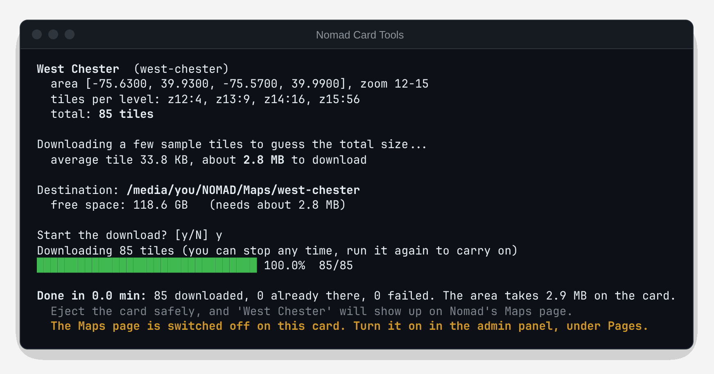

### 12. Build map packs yourself
The same packs as *Download map packs*, but built on your computer from the newest
OpenStreetMap data, for any area Geofabrik lists. You pick the areas and what each one gets
(map detail, directions, search, addresses, nearby essentials, hiking trails), and it shows
what that costs on the card before building anything.

- Directions need a lot of memory, roughly 15 times the area's download. A 300 MB state needs
  about 5 GB. It checks first and tells you if an area is too big for your computer.
- The downloads stay on your computer while it builds, not on the card.
- Needs internet while it builds, nothing after that.

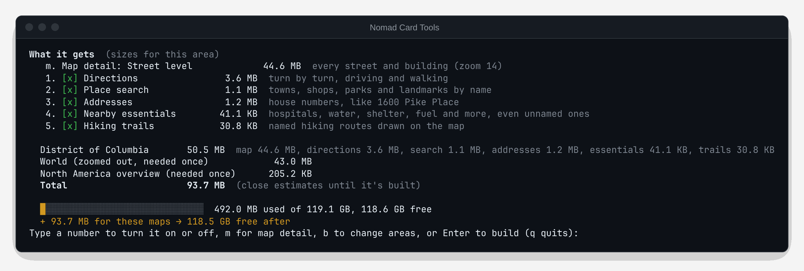

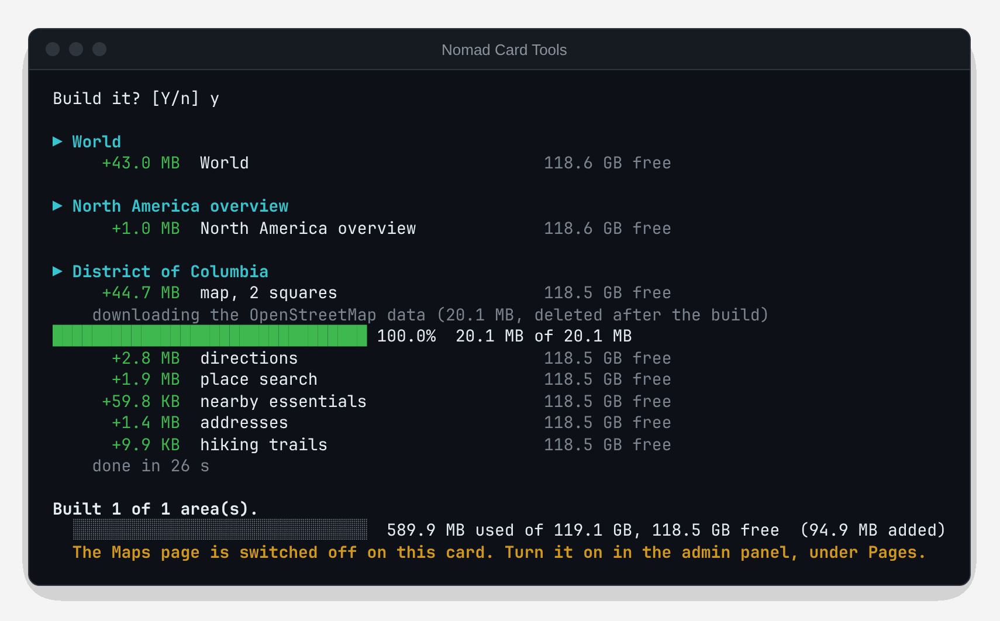

### 13. Map areas and sizes
Shows how much space each state, region or set would take on the card. Doesn't download
anything. Handy for seeing what fits before starting a long download.

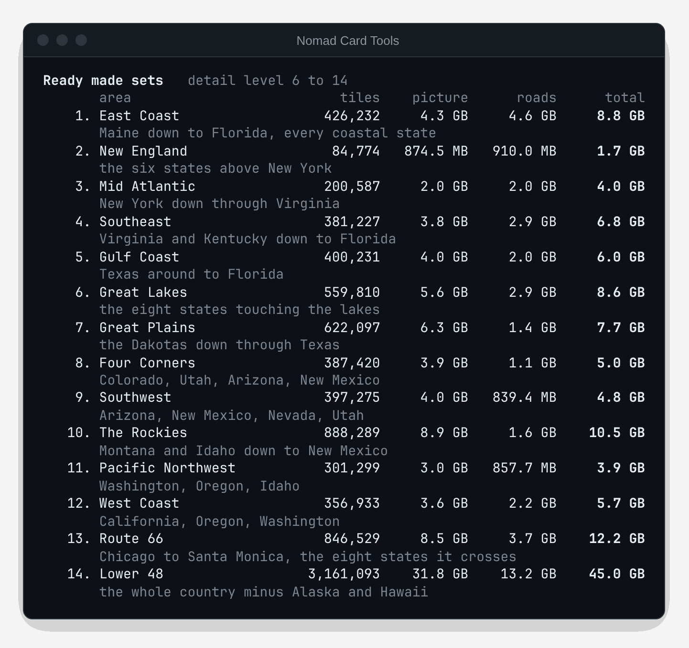

### 14. Shrink map tiles
Converts a map area's tiles to WebP, about 40% smaller. The original tiles get replaced.

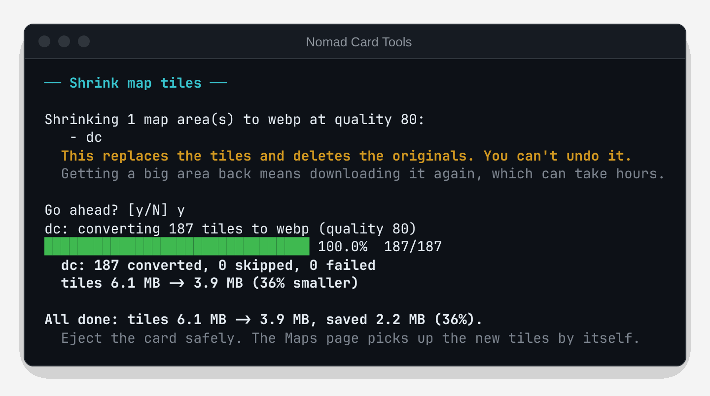

### 15. Translation languages
Installs offline language packs so the **Translate** page works with no internet. Translating
happens on the phone, so Nomad doesn't have to do any heavy lifting.

- Each language works both ways, so English to Spanish and Spanish to English.
- Comes in collections (`starter`, `asia`, `traveler`, `europe`, `world`) or single languages.
  `world` is everything, about 3.8 GB.
- It checks the card has room first and skips packs already on it, so you can run it again to
  add more.

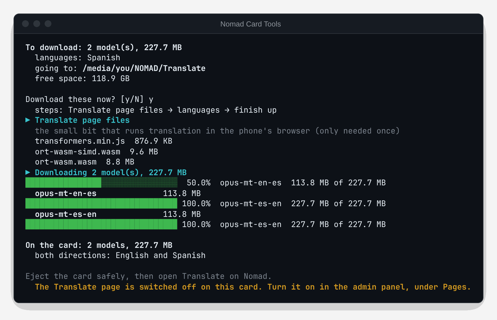

### 16. Format a card
Erases a card and sets it up as exFAT, named `NOMAD`. **Linux only.** It needs `exfatprogs`
and asks for your password.

- This **deletes everything on the card!** It only lists memory cards and other removable
  disks, and you have to type the device path back to confirm.
- On Windows use **Format...** in Explorer instead: exFAT, allocation unit size 4096 bytes
  (8192 on cards over 512 GB). On a Mac, erase it as exFAT in Disk Utility.

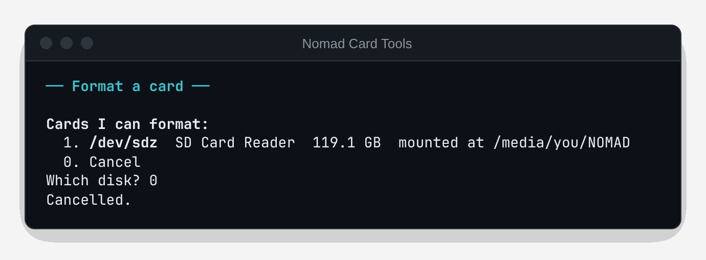

**A good order to do things:** add your media and archives first, fix videos and pictures next,
then rebuild the index last so it has everything. Maps and languages can go on any time.

**Some pages are off on a new card:** Games, Maps, Archive, Chat, Translate, Cookbook and
Workshop. Turn them on in the admin panel under **Pages** (**Menu Pages** before 4.8). The tools let you know if the page you just
added to is off.

---

## What goes where

Each page only reads certain formats and only looks so far into folders. A file outside these
rules still copies, but the page won't list it. `python3 add_media.py --rules` prints this
list too.

| Folder | Formats the page reads | Layout | How deep it looks |
|---|---|---|---|
| `/Movies` | `.avi`, `.m4v`, `.mkv`, `.mov`, `.mp4`, `.webm` | a folder per film, or loose files | any depth |
| `/Shows` | `.avi`, `.m4v`, `.mkv`, `.mov`, `.mp4`, `.webm` | a folder per show, seasons inside it | any depth |
| `/Books` | `.aac`, `.azw3`, `.cb7`, `.cbr`, `.cbt`, `.cbz`, `.djvu`, `.epub`, `.flac`, `.m4a`, `.m4b`, `.mobi`, `.mp3`, `.ogg`, `.pdf`, `.txt`, `.wav` | loose files, or a folder per book or series | one level deep |
| `/Music` | `.aac`, `.aiff`, `.alac`, `.flac`, `.m4a`, `.mp3`, `.ogg`, `.opus`, `.wav` | Artist/Album/song, a playlist folder, or loose songs | any depth |
| `/Gallery` | `.avif`, `.gif`, `.jpeg`, `.jpg`, `.mov`, `.mp4`, `.ogg`, `.png`, `.webm`, `.webp` | loose files, or folders to group them | any depth |
| `/Games` | `.gb`, `.gba`, `.gbc`, `.gen`, `.iwad`, `.md`, `.n64`, `.nes`, `.ps1`, `.psx`, `.sfc`, `.smc`, `.sms`, `.wad` | loose ROMs, or folders to group them | any depth |
| `/Cookbook` | `.cook`, `.json`, `.markdown`, `.md`, `.txt` | loose recipes, or a folder per category | one level deep |
| `/Workshop` | `.3ds`, `.3mf`, `.amf`, `.bgcode`, `.blend`, `.dae`, `.dxf`, `.f3d`, `.gco`, `.gcode`, `.ipt`, `.obj`, `.ply`, `.scad`, `.sldprt`, `.step`, `.stl`, `.stp`, `.svg`, `.zip` | loose models, or a folder per collection | one level deep |
| `/Files` | anything | anything | any depth |

- **`/Shows` only lists folders.** One folder per show, with the seasons inside it. A loose
  episode never shows up.
- **Cover art has the same name as the file,** like `Dune.mp4` + `Dune.jpg`. For a show, put
  the picture inside the show folder named `poster`, `cover`, `folder` or `art`.
- **A zipped ROM keeps its console extension.** `Zelda.nes.zip` works, `Zelda.zip` doesn't.
- **A folder of three or more pictures in `/Books`** (with no ebook or audio file next to
  them) counts as one comic.
- **`.md` in `/Games` is a Sega Mega Drive ROM,** not a text file.
- **A file of 4 GB or more needs an exFAT card.** FAT32 can't hold it.
- **Nothing new shows up until the index is rebuilt.**

**`/Archive`** and **`/Maps`** need more than a copy, so they aren't in the table. Use *Add ZIM
archives* for `.zim` files, and *Download map packs* or *Download map tiles* for maps.

---

## What you need

- **Python 3**, for everything. On Windows, install it from
  [python.org](https://www.python.org/downloads/) and tick **"Add python.exe to PATH"** during
  setup. The launchers install everything else Python needs by themselves.
- **ffmpeg**, for *Fix videos*, *Subtitles*, and for *Pictures* to make stills and audiobook
  covers. Install it with `winget install Gyan.FFmpeg` (Windows), `sudo apt install ffmpeg`
  (Linux) or `brew install ffmpeg` (Mac).
- **Node.js**, only for *Add ZIM archives*. Get it from [nodejs.org](https://nodejs.org).
- **poppler** (`pdftoppm`) or **PyMuPDF**, only for *Pictures* to make covers for PDFs. Without
  either one, PDFs just get skipped. `sudo apt install poppler-utils` (Linux), `brew install
  poppler` (Mac), or `pip install pymupdf`.
- **exfatprogs**, only for *Format a card* (Linux). `sudo apt install exfatprogs`.

---

## When you're done

**Eject the card safely** before you unplug it, then put it back in Nomad.

---

## Advanced (optional)

You can run any tool on its own instead of using the menu. Use `python` on Windows or `python3`
on Linux (from the `.venv` the launcher made if you want the map tools):

```
python3 add_media.py --check                 # what will this card actually show?
python3 add_media.py --rules                 # every folder's formats and layout
python3 add_media.py ~/rips --to Shows       # copy, checking formats first
python3 import_zim.py ~/Downloads            # add every .zim in a folder
python3 zim_prepare.py -o /media/you/NOMAD --all --yes   # speed up every archive on a card
python3 fix_videos.py /media/you/NOMAD --check   # just list what's wrong
python3 pictures.py /media/you/NOMAD --check # what the Pictures jobs would do
python3 subtitles.py /media/you/NOMAD        # subtitles out of every video
python3 build_index.py /media/you/NOMAD      # rebuild the index
python3 translate_packs.py --list            # language packs and sizes
python3 translate_packs.py --add world       # every language, both ways
python3 map_buckets.py --list states         # sizes for every state
python3 map_tiles.py --name "Pennsylvania" --bbox -80.52,39.72,-74.69,42.27 --zooms 6-12
```

Add `-o E:\` (Windows) or `-o /media/you/NOMAD` (Linux) to skip the card picker. Every tool
has `--help` with the rest of its options.

### Map region format

A map region is just a folder in `/Maps` with a `manifest.json` in it. The tools make that for
you, but if you want to make one by hand:

```
/Maps/
  west-chester/
    manifest.json
    tiles/12/1194/1540.jpg      tiles/{z}/{x}/{y}.jpg
```

```json
{
  "id": "west-chester",
  "name": "West Chester, PA",
  "bounds": [-75.70, 39.89, -75.51, 40.03],
  "minZoom": 12,
  "maxZoom": 16,
  "tilePath": "tiles/{z}/{x}/{y}.jpg",
  "attribution": "USGS The National Map",
  "sizeBytes": 24696061
}
```

- `bounds` is `[west, south, east, north]` in degrees.
- `tilePath` is optional and defaults to `tiles/{z}/{x}/{y}.jpg`. Set it if your tiles are
  `.webp` or `.png`.
- Tiles are normal XYZ map tiles, the same kind Leaflet and OpenStreetMap use.
- Nomad lists up to 64 regions, and skips folders that start with `.`.

---

## License

Same as Nomad itself: [CC BY-NC-SA 4.0](LICENSE.md). Free to use, change and share for
non-commercial use, as long as you give credit and share it the same way.
